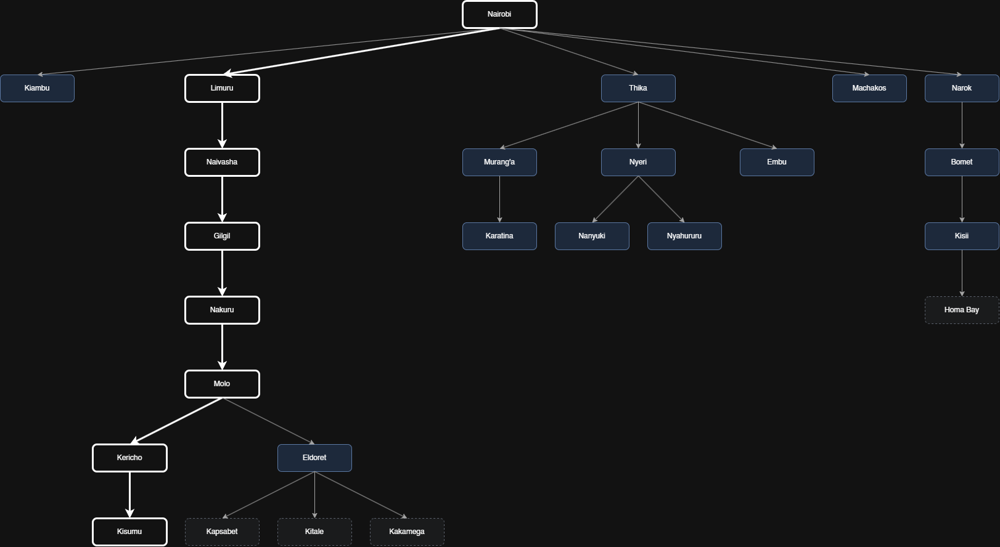
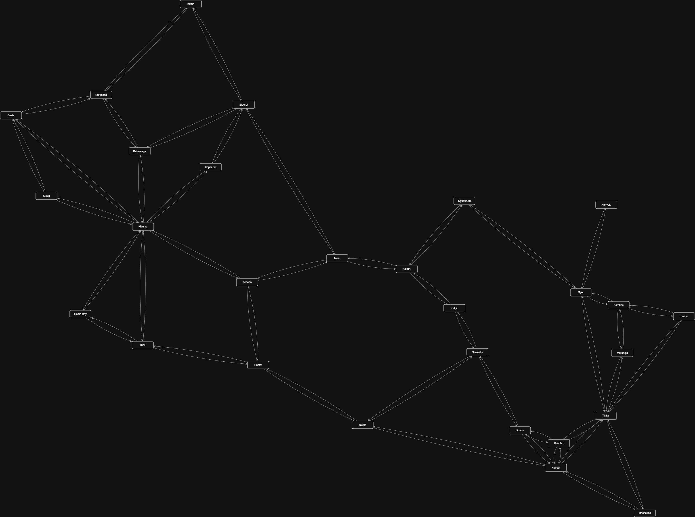

# Design

1. Design the agent using the PEAS framework
- **Performance measure:** customer safety, fuel efficiency through least time taken for a trip, customer satisfaction, distance between towns
- **Environment:** roads, traffic laws, pedestrians and customers
- **Actuators:** steering wheel, accelerator, brake and horn
- **Sensors:** cameras and GPS

3. Develop a suitable graph and search tree
Search Tree showing optimal path

Graph of towns/cities in Central Highlands, Rift Valley and Lake Victoria Basin regions of Kenya

3. Using distance between towns as the path cost function, determine the optimal path the trailer can take from Nairobi to Kisumu

Nairobi -> Limuru = 30
Limuru -> Naivasha = 60
Naivasha -> Gilgil = 30
Gilgil -> Nakuru = 35
Nakuru -> Molo = 45
Molo -> Kericho = 70
Kericho -> Kisumu = 80

Total = 350km 
Real distance is 355km 

